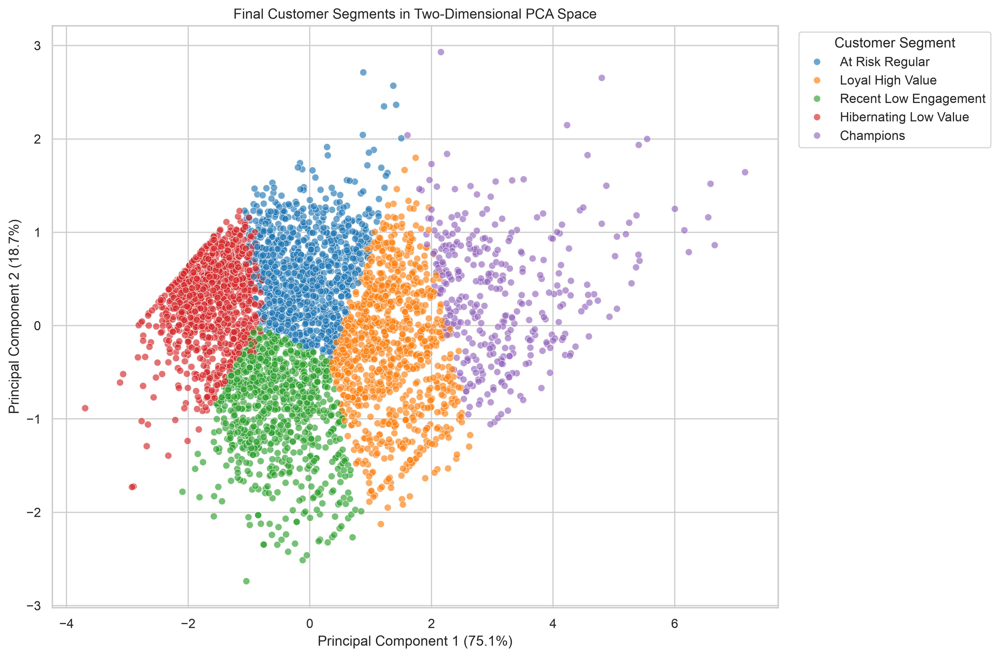
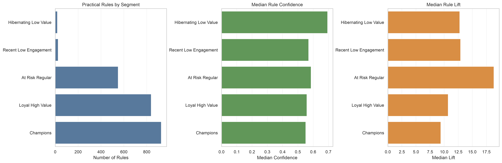

# Online Retail Customer Analytics

A machine-learning and data-mining project that segments retail customers and discovers segment-specific product associations using the UCI Online Retail dataset.

## Project Overview

- **Module:** IT3091 - Machine Learning
- **Institution:** Sri Lanka Institute of Information Technology
- **Group:** 2026-DS-10
- **Project type:** Academic team project
- **Domain:** Retail and e-commerce

The project combines data-quality analysis, RFM feature engineering, clustering-model comparison, stability testing, and association-rule mining to support customer retention, reactivation, loyalty, and cross-selling decisions.

## Business Question

> Which customer groups should receive loyalty, retention, reactivation, and cross-selling strategies, and which product combinations should be promoted within each segment?

## Analytical Workflow

1. Audit and clean 541,909 transaction records.
2. Build valid customer and basket-level analytical datasets.
3. Engineer Recency, Frequency, and Monetary features.
4. Compare K-Means, agglomerative clustering, Gaussian mixtures, and DBSCAN.
5. Test model stability across random seeds and repeated samples.
6. Profile five interpretable customer segments.
7. Mine segment-specific product relationships with FP-Growth.
8. Translate the results into targeted business recommendations.

## Selected Model

The final solution uses **five-cluster K-Means** with log-transformed RFM features and `StandardScaler`.

| Measure | Result |
|---|---:|
| Silhouette score | 0.319 |
| Davies-Bouldin index | 0.983 |
| Calinski-Harabasz score | 3230.99 |
| Mean seed ARI | 0.985 |
| Mean resampling ARI | 0.931 |

The five segments were interpreted as:

- Hibernating Low Value
- Recent Low Engagement
- At Risk Regular
- Loyal High Value
- Champions



## Association Mining

FP-Growth was applied separately to each customer segment using adaptive minimum support. Rules were filtered using support, confidence, lift, leverage, and minimum transaction counts.

- **2,361** practical rules passed the combined quality criteria.
- **40** final recommendations were selected: eight for each customer segment.
- Support sensitivity was evaluated across four thresholds.



## Dataset

The project uses the [UCI Online Retail dataset](https://archive.ics.uci.edu/dataset/352/online+retail), licensed under CC BY 4.0.

The raw dataset is intentionally not committed. Download `Online_Retail.xlsx` from UCI and place it at:

```text
data/raw/Online_Retail.xlsx
```

## Run the Analysis

```bash
pip install -r requirements.txt
jupyter notebook
```

Run the notebooks in this order:

1. `01_data_understanding_eda.ipynb`
2. `02_data_cleaning_preprocessing.ipynb`
3. `03_customer_feature_engineering.ipynb`
4. `04_customer_segmentation_clustering.ipynb`
5. `05_segment_specific_association_mining.ipynb`

## Repository Structure

```text
online-retail-customer-analytics/
|-- README.md
|-- requirements.txt
|-- notebooks/
|-- figures/
|-- results/
|-- documentation/
`-- video/
```

## Team

| Student | Primary responsibility |
|---|---|
| Nirmani K.H.D.T. | Data integration and feature engineering |
| Lakshitha Dilshan J.K.P. | Data understanding, preprocessing, and quality assurance |
| Palliyaguruge C.T. | Clustering implementation and method comparison |
| Senaratne P.A.R.T. | Association-rule mining, evaluation, and recommendations |

All members contributed to problem framing, decision logging, peer review, report integration, reproducibility checks, and the demonstration.

## Demonstration

[Watch the project demonstration](https://youtu.be/Fvtl2KqCjJQ)

## Academic Use

This repository documents a completed team project. Please cite the UCI dataset and avoid presenting the team's work as your own submission.

